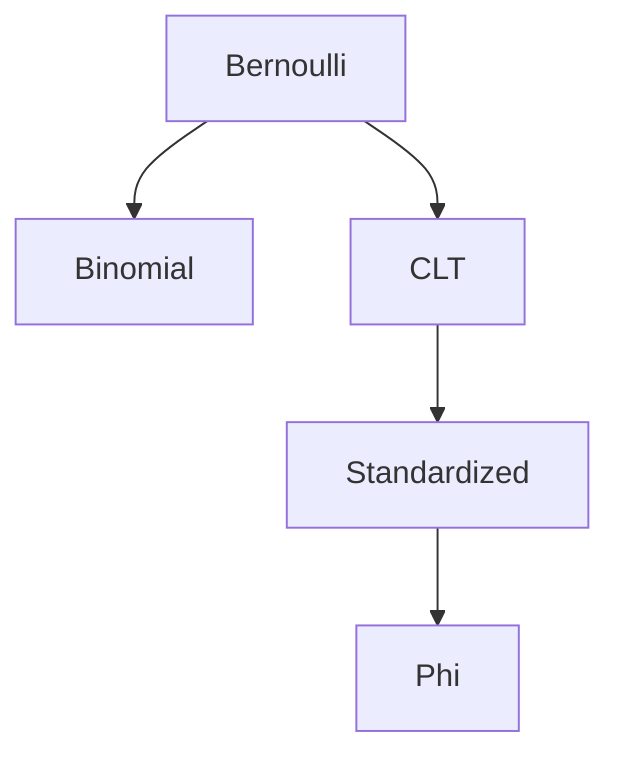

# De Moivre-Laplace Theorem

## Statement

Let $p\in(0,1)$ and let $Y_n\sim\mathrm{Bin}(n,p)$. Then, for every $t\in\mathbb{R}$,
$$
\lim_{n\to\infty}\mathbb{P}\left(
\frac{Y_n-np}{\sqrt{np(1-p)}}\le t
\right)=\Phi(t),
$$
where $\Phi$ is the standard [[normal-distribution]] CDF.

The source writes the approximation form
$$
\mathbb{P}(Y_n\le u)
\approx
\Phi\left(\frac{u-np}{\sqrt{np(1-p)}}\right).
$$

## Assumptions

- $p\in(0,1)$.
- $Y_n\sim\mathrm{Bin}(n,p)$.
- $n$ is large for approximation use.

## Proof sketch

This is the binomial special case of the [[central-limit-theorem]], since a binomial variable is a sum of i.i.d. [[bernoulli-distribution|Bernoulli]]$(p)$ variables.

## Worked example

For $X\sim\mathrm{Bin}(900,1/6)$, the source uses
$$
\mathbb{P}(X\ge200)=1-\mathbb{P}(X\le199)
\approx 1-\Phi\left(\frac{199-150}{\sqrt{125}}\right)
=1-\Phi(4.38)\approx 6\cdot10^{-6}.
$$
It also records
$$
\mathbb{P}(X\ge160)\approx1-\Phi(0.80)\approx0.212.
$$

## See also

[[central-limit-theorem]], [[binomial-distribution]], [[normal-approximation]], [[lecture-block-8-9-exercises]]

