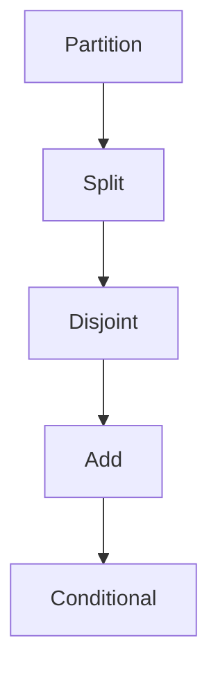

# Law of Total Probability (*Satz von der totalen Wahrscheinlichkeit*)

## Statement

Let $(\Omega,\mathbb{P})$ be a [[discrete-probability-space]] and let $(B_i)_{i\in I}$ be an at most countable collection of disjoint subsets of $\Omega$ such that
$$
\bigcup_{i\in I}B_i=\Omega,
\qquad
\mathbb{P}(B_i)>0\quad\text{for all }i\in I.
$$
Then, for every $A\subseteq\Omega$,
$$
\mathbb{P}(A)=\sum_{i\in I}\mathbb{P}(A\mid B_i)\mathbb{P}(B_i).
$$

## Assumptions

- The $B_i$ form a disjoint partition of $\Omega$.
- Each conditioning event has positive probability.
- The index set is at most countable in the source statement.

## Proof sketch



## When to use it

Use it when the source of an outcome is unknown but can be split into cases, such as machines, faculties, disease status, or transmitted symbols.

## Procedure

```text
1. Choose a partition B_1, B_2, ... of the sample space.
2. Verify every partition event has positive probability.
3. For each case, write the conditional probability \mathbb{P}(A | B_i).
4. Multiply each conditional probability by the case probability \mathbb{P}(B_i).
5. Add the products to obtain \mathbb{P}(A).
```

## Worked examples

### Machine defects

Machine 1 produces $60\%$ of output with defect rate $5\%$; machine 2 produces $40\%$ with defect rate $10\%$. With $A=\{\text{defect}\}$ and $M_i=\{\text{machine }i\}$,
$$
\mathbb{P}(A)=0.05\cdot0.6+0.10\cdot0.4=0.07.
$$

### Admission rates

For women applying to faculties $F_1,F_2,F_3$ with shares $0.80,0.15,0.05$ and conditional admission rates $0.60,0.70,0.80$,
$$
\mathbb{P}(\text{admitted}\mid\text{woman})=0.60\cdot0.80+0.70\cdot0.15+0.80\cdot0.05=0.625.
$$
For men with shares $0.10,0.20,0.70$ and conditional rates $0.50,0.60,0.70$,
$$
\mathbb{P}(\text{admitted}\mid\text{man})=0.50\cdot0.10+0.60\cdot0.20+0.70\cdot0.70=0.66.
$$

## See also

[[conditional-probability]], [[bayes-formula]], [[lecture-block-4-5-exercises]]

