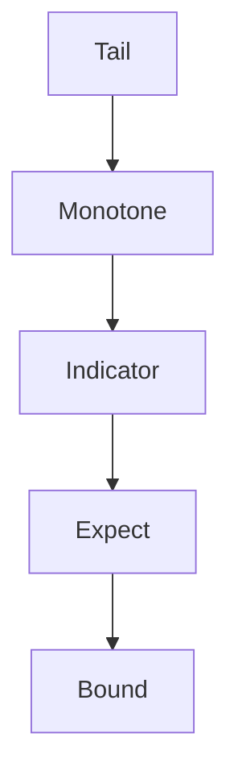

# Markov Inequality

## Statement

Let $X$ be a [[random-variable]] and let $h:[0,\infty)\to[0,\infty)$ be monotonically nondecreasing. If $\mathbb{E}[h(|X|)]<\infty$, then for every $u>0$ with $h(u)>0$,
$$
\mathbb{P}(|X|\ge u)\le\frac{\mathbb{E}[h(|X|)]}{h(u)}.
$$
The common special case is, for nonnegative $X$,
$$
\mathbb{P}(X\ge u)\le\frac{\mathbb{E}[X]}{u}.
$$

## Assumptions

- $h$ is nonnegative and nondecreasing on $[0,\infty)$.
- $\mathbb{E}[h(|X|)]$ is finite.
- $u>0$ and $h(u)>0$.

## Proof sketch

## When to use it

Use Markov when only an expectation or a nonnegative moment is known and a crude tail bound is needed.

## Worked example

For 900 fair die rolls, let $X$ count sixes. Then $X\sim\mathrm{Bin}(900,1/6)$ and $\mathbb{E}[X]=150$. The source gives
$$
\mathbb{P}(X\ge200)\le\frac{150}{200},\qquad
\mathbb{P}(X\ge160)\le\frac{150}{160}.
$$

## See also

[[chebyshev-inequality]], [[weak-law-large-numbers]], [[normal-approximation]], [[lecture-block-8-9-exercises]]

