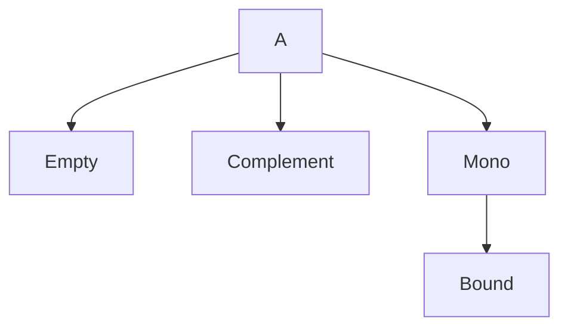

# Probability Rules

## Statement

For events in a [[discrete-probability-space]] $(\Omega,\mathbb{P})$:

1. $\mathbb{P}(\varnothing)=0$.
2. If $A_1,\ldots,A_n$ are pairwise disjoint, then
   $$
   \mathbb{P}\left(\bigcup_{k=1}^{n}A_k\right)=\sum_{k=1}^{n}\mathbb{P}(A_k).
   $$
3. Complement rule:
   $$
   \mathbb{P}(A^c)=1-\mathbb{P}(A),
   \qquad \mathbb{P}(A)+\mathbb{P}(A^c)=1.
   $$
4. Monotonicity: if $A\subseteq B\subseteq\Omega$, then
   $$
   \mathbb{P}(A)\le \mathbb{P}(B).
   $$
5. Union bound: for events $A_1,
\ldots,A_n$,
   $$
   \mathbb{P}\left(\bigcup_{k=1}^{n}A_k\right)\le \sum_{k=1}^{n}\mathbb{P}(A_k).
   $$
6. Difference rule: if $A\subseteq B$, then
   $$
   \mathbb{P}(B\setminus A)=\mathbb{P}(B)-\mathbb{P}(A).
   $$
7. Intersection via complement:
   $$
   \mathbb{P}(A\cap B)=\mathbb{P}(A)-\mathbb{P}(A\cap B^c).
   $$

## Assumptions

- All events are subsets of the same sample space $\Omega$.
- Additivity statements require pairwise disjointness unless using [[inclusion-exclusion-principle]].

## Proof sketch

The notes explicitly prove the difference rule by writing $B=(B\setminus A)\cup A$ as a disjoint union, and prove the intersection identity by writing $A=(A\cap B)\cup(A\cap B^c)$.

## When to use it

Use these rules to simplify event expressions before counting, especially when complements are easier than direct enumeration.

## Worked example

In the bus-stop exercise, the event "at least one passenger gets off at every stop" is easier as the complement of "some stop gets no passengers," then solved with [[inclusion-exclusion-principle]].

## See also

[[discrete-probability-space]], [[laplace-probability-space]], [[lecture-block-1-2-exercises]]

